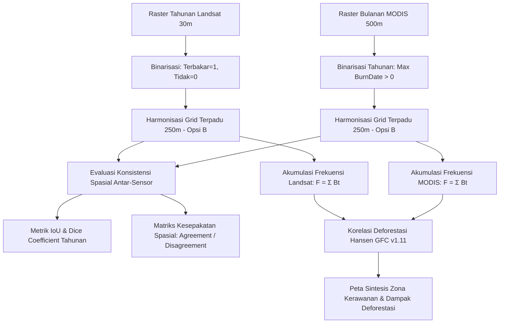

# Analisis Frekuensi Area Terbakar Berulang dan Konsistensi Spasial antara Produk Landsat dan MODIS di Kabupaten Pulang Pisau, Kalimantan Tengah, Periode 2001–2024

**Mata Kuliah:** Pengolahan Citra Digital (PCD) — Semester 5  
**Program Studi:** D4 Teknik Informatika, Jurusan Teknik Komputer dan Informatika  
**Institusi:** Politeknik Negeri Bandung (POLBAN)  
**Tahun Akademik:** 2026/2027  

---

## 👥 Tim Pengembang (Kelompok)

| Nama Mahasiswa | NIM | Program Studi | Peran Utama |
| :--- | :--- | :--- | :--- |
| **Roufiel Hadi** | **241524028** | D4 Teknik Informatika | Arsitektur Sistem, Pipeline Pengolahan Raster GEE & Harmonisasi Spasial |
| **Amalia Khoerina** | **241524003** | D4 Teknik Informatika | Evaluasi Metrik Konsistensi (IoU, Dice), Analisis Deforestasi & Web Dashboard |

---

## 📌 Ringkasan Eksekutif & Latar Belakang

Kebakaran hutan dan lahan (karhutla) merupakan persoalan lingkungan berulang yang berdampak luas di Indonesia, mencakup degradasi ekosistem gambut, gangguan kabut asap lintas wilayah, hingga pelepasan emisi karbon dalam skala masif. Kabupaten Pulang Pisau di Provinsi Kalimantan Tengah merupakan salah satu wilayah yang paling terdampak akibat sejarah pembukaan saluran drainase gambut pada proyek eks-PLG (Pengembangan Lahan Gambut) Sejuta Hektar.

Proyek ini bertujuan memetakan **frekuensi area terbakar berulang selama rentang 2001–2024** serta mengevaluasi **konsistensi spasial antara dua produk penginderaan jauh multi-sensor**:
1. **Produk Berbasis Landsat (Resolusi Tinggi 30m):** MapBiomas Fire Indonesia Collection 2 / Landsat SR Burn Scars.
2. **Produk MODIS Burned Area (Resolusi Menengah 500m):** NASA MODIS MCD64A1 Collection 6.1.
3. **Analisis Pelengkap:** Mengintegrasikan data **Hansen Global Forest Change (GFC) v1.11** untuk membuktikan secara spasial korelasi antara kebakaran berulang dengan hilangnya tutupan kanopi hutan lebat (deforestasi).

---

## 🎯 Rumusan Masalah & Pertanyaan Penelitian

1. Bagaimana distribusi spasial frekuensi area terbakar berulang di Kabupaten Pulang Pisau selama periode 2001–2024?
2. Bagaimana perbandingan luas area terbakar tahunan yang dipetakan oleh produk Landsat (30m) dan MODIS (500m)?
3. Seberapa tinggi tingkat kesesuaian/konsistensi spasial antarsensor yang diukur menggunakan metrik **Intersection over Union (IoU / Jaccard Index)** dan **Dice Similarity Coefficient** pada grid analisis terpadu 250m?
4. Di bagian mana ketidaksepakatan (*omission/commission error*) paling dominan terjadi antarsensor?
5. Seberapa kuat korelasi antara zona frekuensi kebakaran berulang ($\ge 2$ kali terbakar) terhadap deforestasi tutupan kanopi pohon?

---

## 🔬 Metodologi Pengolahan Citra Digital (PCD)



### 1. Binarisasi Tahunan & Akumulasi Frekuensi Terbakar
Untuk setiap tahun $t \in [2001, 2024]$, piksel diklasifikasikan biner:
$$B_t(x, y) = \begin{cases} 1, & \text{jika terdeteksi terbakar} \\ 0, & \text{jika valid dan tidak terbakar} \\ \text{NoData}, & \text{jika tidak teramati/tertutup awan} \end{cases}$$

Frekuensi piksel terbakar dihitung dengan akumulasi:
$$F(x, y) = \sum_{t=2001}^{2024} B_t(x, y)$$

**Klasifikasi Kelas Frekuensi:**
* **0 tahun:** Tidak pernah terdeteksi terbakar.
* **1 tahun:** Terbakar 1 kali (kebakaran insidental).
* **2–4 tahun:** Frekuensi Rendah–Sedang.
* **5–8 tahun:** Frekuensi Sedang–Tinggi.
* **$\ge 9$ tahun:** Frekuensi Sangat Tinggi (titik rawan kronis).

### 2. Harmonisasi Spasial (Grid Terpadu 250m — Opsi B)
Untuk menghindari bias resolusi (Landsat 30m vs MODIS 500m), analisis perbandingan dilakukan pada **grid analisis terpadu 250 meter** dengan aturan agregasi fraksi dan resampling berbasis nearest/bilinear.

### 3. Metrik Konsistensi Spasial
* **Intersection over Union (IoU):**
  $$\text{IoU} = \frac{|A \cap B|}{|A \cup B|}$$
* **Dice Similarity Coefficient:**
  $$\text{Dice} = \frac{2 \times |A \cap B|}{|A| + |B|}$$

---

## 📁 Struktur Repositori Terencana

```text
.
├── README.md                 # Dokumentasi utama proyek & identitas kelompok
├── ARCHITECTURE.md           # Arsitektur sistem & alur pemrosesan citra digital
├── METRICS.md                # Perumusan matematis PCD dan formulasi metrik
├── .gitignore                # Filter raster besar (.tif, .hdf, .nc) agar repo tetap bersih
├── gee/                      # Skrip Google Earth Engine (JavaScript API)
│   └── landsat_modis_fire_pipeline.js
├── notebooks/                # Jupyter / Google Colab Notebooks
│   └── analisis_konsistensi_karhutla_colab.ipynb
├── web/                      # Dashboard GIS interaktif (Leaflet.js & Chart.js)
│   ├── index.html
│   ├── css/styles.css
│   └── js/app.js
└── data/                     # Data batas AOI GeoJSON & metrik JSON (non-raster)
    ├── geojson/
    └── time_series_fire_consistency.json
```

---

## 📚 Rujukan Ilmiah Utama

1. **Papilaya, F. S. (2020).** *Analisis Pola Spasial Kebakaran Lahan di Kabupaten Pulang Pisau Tahun 2001–2019*. Jurnal Tunas Geografi, 9(1), 1-10. DOI: [10.24114/tgeo.v9i1.17365](https://doi.org/10.24114/tgeo.v9i1.17365)
2. **Vetrita, Y., & Cochrane, M. A. (2020).** *Fire Frequency and Related Land-Use and Land-Cover Changes in Indonesia’s Peatlands*. Remote Sensing, 12(1), 5. DOI: [10.3389/ffgc.2024.1221797](https://doi.org/10.3389/ffgc.2024.1221797)
3. **MapBiomas Fire Indonesia (2024).** *Approach and Theoretical Basis Methodological Document (ATBD) - Collection 2*.
4. **Giglio, L., dkk. (2018).** *Collection 6 MODIS Burned Area Product User's Guide (MCD64A1)*. NASA Land Processes Distributed Active Archive Center (LP DAAC).
5. **Hansen, M. C., dkk. (2013).** *High-Resolution Global Maps of 21st-Century Forest Cover Change*. Science, 342(6160), 850-853.
