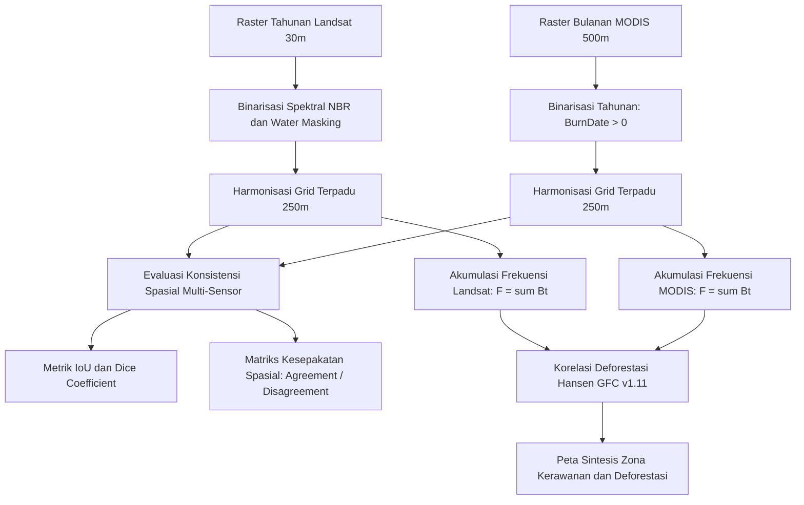

# Analisis Frekuensi Area Terbakar Berulang dan Konsistensi Spasial antara Produk Landsat dan MODIS di Kabupaten Pulang Pisau, Kalimantan Tengah, Periode 2001–2024

**Mata Kuliah:** Pengolahan Citra Digital (PCD) — Semester 5  
**Program Studi:** D4 Teknik Informatika, Jurusan Teknik Komputer dan Informatika  
**Institusi:** Politeknik Negeri Bandung (POLBAN)  
**Tahun Akademik:** 2026/2027  

[](https://roufielhadi.github.io/Analisis-Kebakaran-Hutan-Pulang-Pisau/)
[](https://colab.research.google.com/github/RoufielHadi/Analisis-Kebakaran-Hutan-Pulang-Pisau/blob/main/notebooks/analisis_karhutla_pulang_pisau.ipynb)

---

## Tim Peneliti

| Nama Mahasiswa | NIM | Program Studi | Peran Utama |
| :--- | :--- | :--- | :--- |
| **Roufiel Hadi** | **241524028** | D4 Teknik Informatika | Arsitektur Sistem, Pipeline Pengolahan Raster GEE dan Harmonisasi Spasial |
| **Amalia Khoerina** | **241524003** | D4 Teknik Informatika | Evaluasi Metrik Konsistensi Spasial (IoU, Dice), Analisis Deforestasi, dan Web GIS |

---

## Ringkasan Eksekutif dan Latar Belakang

Kebakaran hutan dan lahan (karhutla) merupakan persoalan lingkungan berulang di Indonesia yang berdampak signifikan terhadap degradasi ekosistem gambut, gangguan kabut asap, dan pelepasan emisi karbon. Kabupaten Pulang Pisau di Provinsi Kalimantan Tengah merupakan salah satu wilayah dengan kerawanan tinggi akibat sejarah pembuatan saluran drainase gambut pada proyek eks-Pengembangan Lahan Gambut (PLG) Sejuta Hektar.

Penelitian ini memetakan **frekuensi area terbakar berulang selama rentang waktu 2001–2024** serta mengevaluasi **konsistensi spasial antara dua produk penginderaan jauh multi-sensor**:
1. **Produk Berbasis Landsat (Resolusi 30 meter):** Ekstraksi Normalized Burn Ratio (NBR) terkalibrasi dengan Surface Reflectance Tier 1 dan penyaringan badan air.
2. **Produk MODIS Burned Area (Resolusi 500 meter):** NASA MODIS MCD64A1 Collection 6.1 bulanan.
3. **Analisis Korelasi Deforestasi:** Integrasi data **Hansen Global Forest Change (GFC) v1.11** untuk membuktikan hubungan antara frekuensi kebakaran berulang dengan kehilangan tutupan kanopi pohon.

---

## Rumusan Masalah dan Tujuan Penelitian

1. Menganalisis distribusi spasial frekuensi area terbakar berulang di Kabupaten Pulang Pisau periode 2001–2024.
2. Membandingkan estimasi luas area terbakar tahunan antara produk berbasis Landsat (30 m) dan MODIS (500 m).
3. Mengukur tingkat kesesuaian spasial antarsensor menggunakan metrik **Intersection over Union (IoU / Jaccard Index)** dan **Dice Similarity Coefficient** pada grid analisis terpadu 250 meter.
4. Mengidentifikasi pola ketidaksepakatan (*omission/commission error*) antara kedua produk satelit.
5. Mengevaluasi proporsi kehilangan tutupan kanopi pohon yang berada di dalam zona kebakaran berulang.

---

## Metodologi Pengolahan Citra Digital



### 1. Binarisasi Tahunan dan Akumulasi Frekuensi
Untuk setiap tahun $t \in [2001, 2024]$, piksel diklasifikasikan secara biner:
$$B_t(x, y) = \begin{cases} 1, & \text{jika piksel terklasifikasi terbakar dan bukan badan air} \\ 0, & \text{jika valid dan tidak terbakar} \\ \text{NoData}, & \text{jika tertutup awan atau di luar wilayah studi} \end{cases}$$

Akumulasi frekuensi terbakar dihitung melalui penjumlahan temporal:
$$F(x, y) = \sum_{t=2001}^{2024} B_t(x, y)$$

**Klasifikasi Kelas Frekuensi:**
* **0 tahun:** Tidak pernah terdeteksi terbakar.
* **1 tahun:** Terbakar 1 kali (kebakaran insidental).
* **2–4 tahun:** Frekuensi Rendah–Sedang.
* **5–8 tahun:** Frekuensi Sedang–Tinggi.
* **$\ge 9$ tahun:** Frekuensi Sangat Tinggi (titik rawan kronis).

### 2. Harmonisasi Spasial (Grid Terpadu 250 meter)
Untuk menjembatani perbedaan resolusi nominal Landsat (30 m) dan MODIS (500 m), evaluasi komparatif diterapkan pada **grid analisis terpadu 250 meter** menggunakan reduksi fraksi area untuk Landsat dan resampling berbasis nearest/bilinear untuk MODIS.

### 3. Metrik Evaluasi Konsistensi Spasial
* **Intersection over Union (IoU):**
  $$\text{IoU} = \frac{|A \cap B|}{|A \cup B|}$$
* **Dice Similarity Coefficient:**
  $$\text{Dice} = \frac{2 \times |A \cap B|}{|A| + |B|}$$

---

## Struktur Repositori

```text
.
├── README.md                 # Dokumentasi utama proyek dan identitas tim
├── ARCHITECTURE.md           # Arsitektur sistem dan alur pemrosesan data raster
├── METRICS.md                # Perumusan matematis PCD dan formulasi metrik
├── .gitignore                # Pengecualian berkas biner besar (.tif, .hdf, .nc)
├── analisis_raster.py        # Skrip Python untuk evaluasi raster dan visualisasi
├── index.html                # Antarmuka Web GIS interaktif (GitHub Pages)
├── gee/                      # Skrip pemrosesan Google Earth Engine
│   └── landsat_modis_fire_pipeline.js
├── notebooks/                # Notebook Google Colab / Jupyter
│   └── analisis_karhutla_pulang_pisau.ipynb
├── output/                   # Grafik publikasi ilmiah dan ringkasan metrik CSV
│   ├── peta_komparasi_4panel.png
│   ├── distribusi_frekuensi_terbakar.png
│   ├── tren_deforestasi_tahunan.png
│   └── ringkasan_metrik_pcd.csv
├── assets/                   # Aset visual pendukung Web GIS
│   ├── css/style.css
│   ├── js/app.js
│   └── raster/               # Lapisan overlay transparan
└── data/                     # Batas administratif GeoJSON dan runtun waktu JSON
    ├── pulang_pisau.geojson
    └── time_series.json
```

---

## Ringkasan Hasil Analisis Data Empiris (2001–2024)

| Parameter Analisis | Nilai Kuantitatif | Keterangan / Implikasi Ilmiah |
| :--- | :---: | :--- |
| **Total Piksel Landsat Terbakar ($F \ge 1$)** | 158.772 piksel ($992.325,0\text{ ha}$) | Deteksi resolusi detail 30 m teragregasi 250 m |
| **Total Piksel MODIS Terbakar ($F \ge 1$)** | 135.913 piksel ($849.456,2\text{ ha}$) | Deteksi resolusi 500 m ter-resample 250 m |
| **Irisan Kesepakatan (*Mutual Agreement*)** | **58.833 piksel ($367.706,2\text{ ha}$)** | Kedua sensor secara konsisten mendeteksi kebakaran |
| **Metrik IoU (Jaccard Index)** | **0,2494 (24,94%)** | Tingkat kesesuaian spasial kumulatif 24 tahun |
| **Dice Similarity Coefficient** | **0,3993 (39,93%)** | Ukuran kesamaan spasial antarsensor |
| **Total Deforestasi Hansen GFC (2001–2023)** | 226.995 piksel ($1.418.718,8\text{ ha}$) | Total kehilangan tutupan kanopi pohon |
| **Deforestasi di Zona Karhutla Berulang ($F \ge 2$)** | **86.602 piksel ($541.262,5\text{ ha}$)** | **38,15% deforestasi dipicu oleh kebakaran berulang** |

---

## Panduan Eksekusi

### 1. Menjalankan Skrip Python Lokal
```powershell
python analisis_raster.py
```
Hasil perhitungan dan gambar visualisasi akan diperbarui pada direktori `output/`.

### 2. Menjalankan di Google Colab
Buka berkas `notebooks/analisis_karhutla_pulang_pisau.ipynb` atau gunakan tautan Google Colab yang tersedia di bagian atas dokumen.

---

## Rujukan Ilmiah Utama

1. **Papilaya, F. S. (2020).** *Analisis Pola Spasial Kebakaran Lahan di Kabupaten Pulang Pisau Tahun 2001–2019*. Jurnal Tunas Geografi, 9(1), 1-10. DOI: [10.24114/tgeo.v9i1.17365](https://doi.org/10.24114/tgeo.v9i1.17365)
2. **Vetrita, Y., & Cochrane, M. A. (2020).** *Fire Frequency and Related Land-Use and Land-Cover Changes in Indonesia’s Peatlands*. Remote Sensing, 12(1), 5. DOI: [10.3389/ffgc.2024.1221797](https://doi.org/10.3389/ffgc.2024.1221797)
3. **MapBiomas Fire Indonesia (2024).** *Approach and Theoretical Basis Methodological Document (ATBD) - Collection 2*.
4. **Giglio, L., dkk. (2018).** *Collection 6 MODIS Burned Area Product User's Guide (MCD64A1)*. NASA Land Processes Distributed Active Archive Center (LP DAAC).
5. **Hansen, M. C., dkk. (2013).** *High-Resolution Global Maps of 21st-Century Forest Cover Change*. Science, 342(6160), 850-853.
